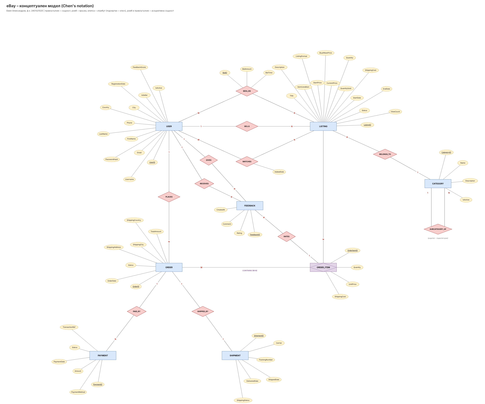
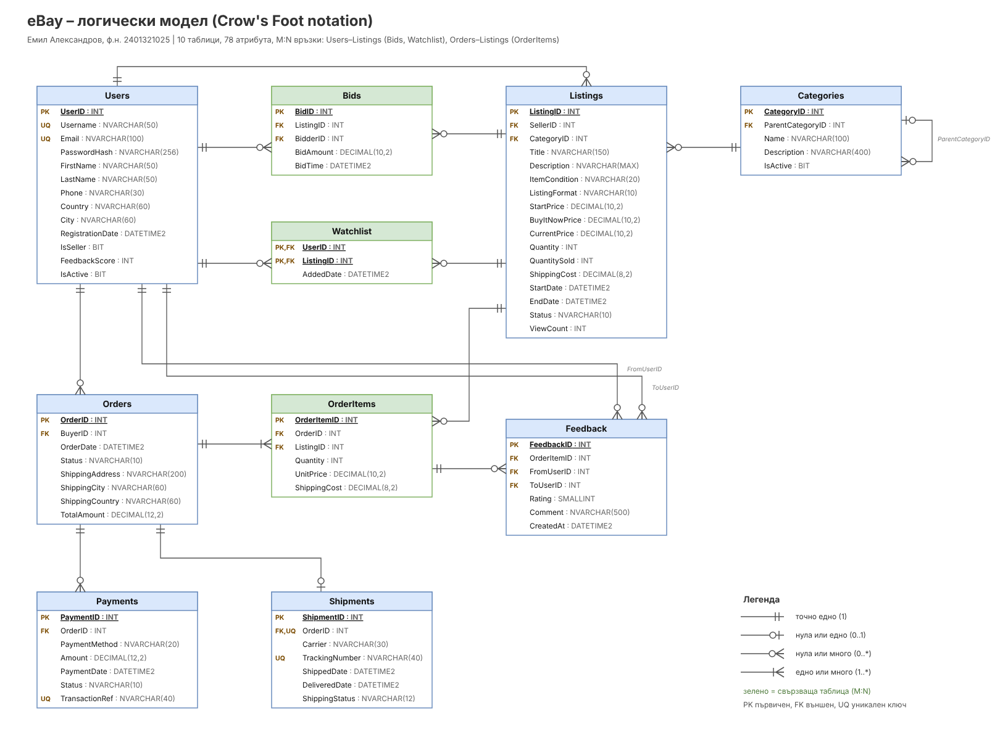
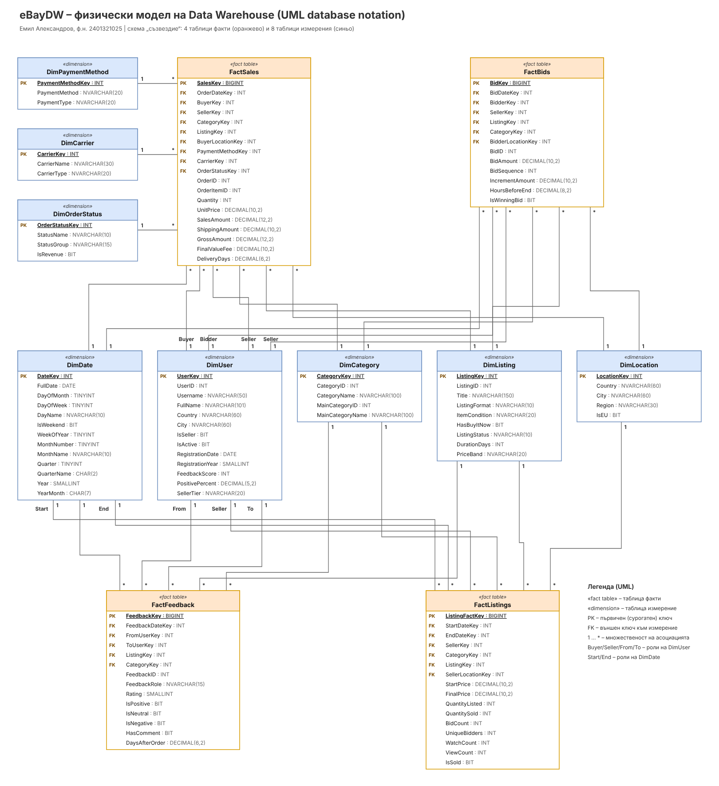

# eBay – база данни, Data Warehouse и Power BI отчет

| | |
|---|---|
| **Студент** | Емил Александров |
| **Факултетен номер** | 2401321025 |
| **Тема (платформа)** | eBay |
| **СУБД** | Microsoft SQL Server 2019+ |
| **BI инструмент** | Power BI Desktop |

## Описание на проекта

Проектът моделира основната дейност на онлайн платформата **eBay**: потребители, които продават и купуват;
обяви в йерархия от категории, като всяка обява е **търг** (*Auction*) или **„Купи сега“** (*Buy It Now*);
наддавания, следени обяви (*Watchlist*), поръчки с един или повече артикула, плащания, доставки и
взаимни оценки (*Feedback*) между купувач и продавач.

Разработката включва:

1. **Концептуален модел** (Chen's notation) – 8 същности (вкл. асоциативна) и 12 връзки.
2. **Логически модел** (Crow's Foot notation) – **10 таблици, 78 атрибута**, три връзки много към много:
   * `Users ↔ Listings` чрез **Bids** (наддавания);
   * `Users ↔ Listings` чрез **Watchlist** (следени обяви);
   * `Orders ↔ Listings` чрез **OrderItems** (редове на поръчка).
3. **OLTP база данни `eBayDB`** в MS SQL Server, с ограничения (PK, FK, UNIQUE, CHECK, DEFAULT) и индекси:
   * **4 функции**: `fn_GetBidIncrement`, `fn_GetMinNextBid`, `fn_GetSellerPositivePercent` и
     табличната `fn_GetActiveListingsByCategory` (с рекурсивен CTE по дървото от категории);
   * **6 съхранени процедури**: `sp_PlaceBid`, `sp_BuyItNow`, `sp_CloseEndedAuctions`, `sp_ShipOrder`,
     `sp_LeaveFeedback`, `sp_GetSellerReport` (с транзакции и обработка на грешки);
   * **5 тригера**: `trg_Bids_AfterInsert` (валидация + текуща цена), `trg_Feedback_UpdateScore`,
     `trg_OrderItems_RecalcTotal`, `trg_Shipments_SyncOrderStatus`, `trg_Listings_SoftDelete` (INSTEAD OF DELETE);
   * **3 изгледа**: `vw_ActiveListings`, `vw_SellerPerformance`, `vw_MonthlySales`;
   * **~6 000 реда тестови данни** за периода 01.2024 – 11.2026: 90 потребители от 13 държави, 31 категории,
     520 обяви, 1 349 наддавания, 799 поръчки, 906 реда в поръчки, плащания, доставки и 1 042 оценки.
4. **Data Warehouse `eBayDW`** – схема „съзвездие“ (fact constellation):
   * **4 таблици факти**: `FactSales`, `FactBids`, `FactFeedback`, `FactListings`;
   * **8 таблици измерения**: `DimDate`, `DimUser`, `DimCategory`, `DimListing`, `DimLocation`,
     `DimPaymentMethod`, `DimCarrier`, `DimOrderStatus`;
   * ETL процедура `sp_LoadDW`, която зарежда DW от `eBayDB`, и дневник `EtlLog`.
5. **Power BI отчет** върху DW: 2 страници с 11 визуализации и 23 DAX мерки.

## Диаграми

| Модел | Нотация | Файл (draw.io) | Изображение |
|---|---|---|---|
| Концептуален | Chen | [`diagrams/01_conceptual_chen.drawio`](diagrams/01_conceptual_chen.drawio) | [PNG](diagrams/01_conceptual_chen.png) |
| Логически | Crow's Foot | [`diagrams/02_logical_crowsfoot.drawio`](diagrams/02_logical_crowsfoot.drawio) | [PNG](diagrams/02_logical_crowsfoot.png) |
| Data Warehouse (физически) | UML | [`diagrams/03_datawarehouse_uml.drawio`](diagrams/03_datawarehouse_uml.drawio) | [PNG](diagrams/03_datawarehouse_uml.png) |

`.drawio` файловете се отварят и редактират в [app.diagrams.net](https://app.diagrams.net) (File → Open from → Device)
или в draw.io Desktop.

### Концептуален модел (Chen)


### Логически модел (Crow's Foot)


### Data Warehouse (UML)


## Структура на папката

```
2401321025-ebay/
├── README.md
├── database/
│   ├── 01_create_database.sql     # база eBayDB, таблици, ограничения, индекси
│   ├── 02_programmability.sql     # функции, процедури, тригери, изгледи
│   ├── 03_seed_data.sql           # тестови данни
│   └── 04_demo_queries.sql        # демонстрация + аналитични заявки (по желание)
├── datawarehouse/
│   ├── 01_create_dw.sql           # база eBayDW – факти и измерения
│   └── 02_etl_load.sql            # ETL процедура sp_LoadDW + първоначално зареждане
├── diagrams/                      # .drawio + .png
└── powerbi/
    ├── POWERBI_GUIDE.md           # модел, връзки, визуализации, контролни стойности
    ├── measures.dax               # DAX мерки
    └── eBay_Report.pbix           # Power BI отчет
```

## Инсталация и стартиране

### Изисквания
* Microsoft SQL Server 2019 или по-нов (Developer / Express edition);
* SQL Server Management Studio (SSMS) или Azure Data Studio;
* Power BI Desktop (за отчета);
* draw.io (app.diagrams.net) – за отваряне на диаграмите.

### Стъпки (SSMS)

Отворете всеки файл в SSMS (**File → Open → File…**) и го изпълнете с **Execute (F5)** **в този ред**:

| # | Файл | Резултат |
|---|---|---|
| 1 | `database/01_create_database.sql` | създава `eBayDB` и таблиците |
| 2 | `database/02_programmability.sql` | функции, процедури, тригери, изгледи |
| 3 | `database/03_seed_data.sql` | зарежда тестовите данни и показва броя редове по таблици |
| 4 | `datawarehouse/01_create_dw.sql` | създава `eBayDW` |
| 5 | `datawarehouse/02_etl_load.sql` | създава `sp_LoadDW` и зарежда DW |
| 6 | `database/04_demo_queries.sql` | *(по желание)* демонстрира процедурите, функциите и тригерите |

> Скриптовете 1 и 4 изтриват и създават базата наново, затова могат да се пускат многократно.
> След промени в `eBayDB` DW се опреснява с `EXEC eBayDW.dbo.sp_LoadDW;`.

### Стъпки (команден ред, sqlcmd)

```bat
cd course-work\implementations\2401321025-ebay
sqlcmd -S localhost -E -i database\01_create_database.sql
sqlcmd -S localhost -E -i database\02_programmability.sql
sqlcmd -S localhost -E -i database\03_seed_data.sql
sqlcmd -S localhost -E -i datawarehouse\01_create_dw.sql
sqlcmd -S localhost -E -i datawarehouse\02_etl_load.sql
```
(при SQL Server Express използвайте `-S localhost\SQLEXPRESS`)

### Power BI
Отворете `powerbi/eBay_Report.pbix` → **Home → Transform data → Data source settings** → сменете сървъра,
ако е различен от `localhost` → **Refresh**. Пълните инструкции за изграждане на отчета от нулата са в
[`powerbi/POWERBI_GUIDE.md`](powerbi/POWERBI_GUIDE.md).

## Примери за използване

```sql
USE eBayDB;

-- минимална следваща оферта и наддаване (42 = ID на активен търг)
SELECT dbo.fn_GetMinNextBid(42);
EXEC dbo.sp_PlaceBid @ListingID = 42, @BidderID = 50, @Amount = 150.00;

-- активни обяви в „Electronics“ и всички подкатегории
SELECT * FROM dbo.fn_GetActiveListingsByCategory(1);

-- отчет за продавач за 2025 г.
EXEC dbo.sp_GetSellerReport @SellerID = 1, @From = '2025-01-01', @To = '2025-12-31';

-- приключване на изтеклите търгове (създава поръчки за печелившите)
EXEC dbo.sp_CloseEndedAuctions;
```

## Допълнения извън минималните изисквания

* 10 таблици / 78 атрибута (изискване: 6 / 30) и три M:N връзки (изискване: 1).
* 4 функции, 6 процедури, 5 тригера (изискване: по 1), плюс 3 изгледа и индекси.
* Бизнес правила в базата: стъпки за наддаване като в eBay, забрана продавач да наддава по своя обява,
  автоматична текуща цена, оценъчен рейтинг, *soft delete* на обяви с история.
* Реалистични и консистентни тестови данни (поръчки, плащания, доставки и оценки, които си съответстват).
* DW с 4 факта и 8 измерения (изискване: 3 / 6), role-playing измерения, ETL процедура с дневник.
* Power BI отчет с 11 визуализации на 2 страници и 23 DAX мерки (изискване: 3 визуализации).
* Диаграмите са в редактируем формат `.drawio` и като PNG.
